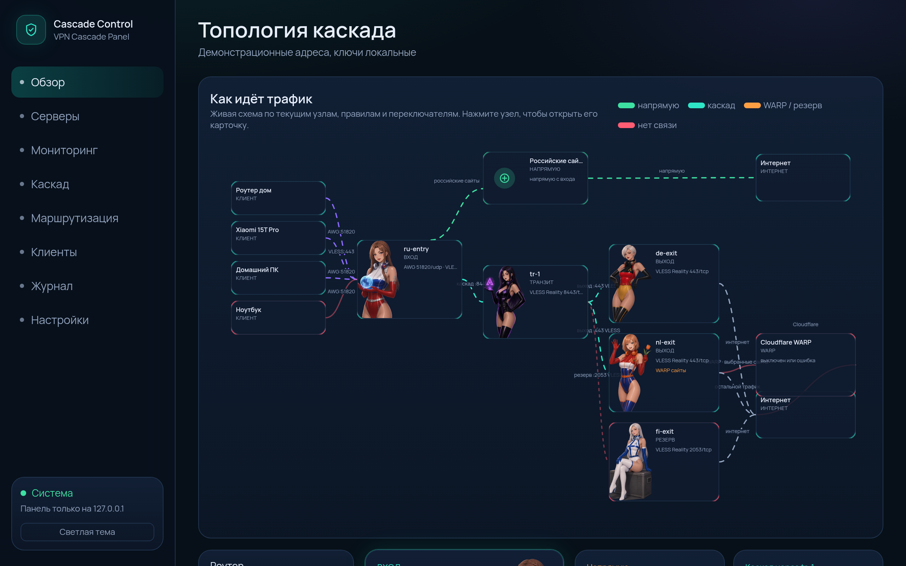
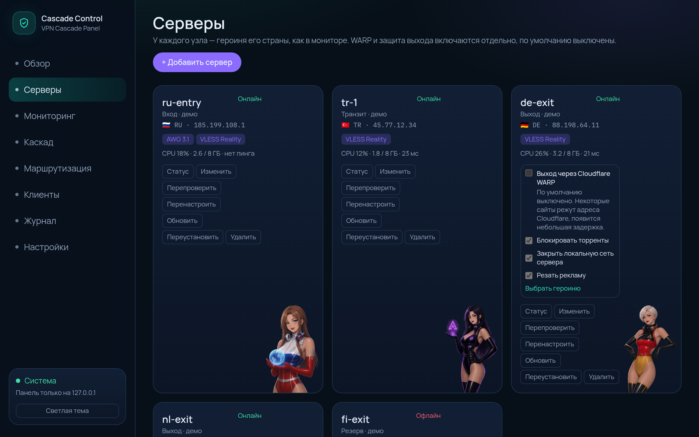
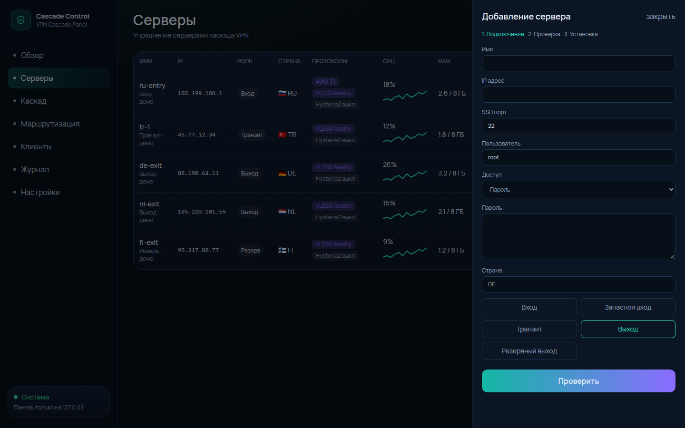
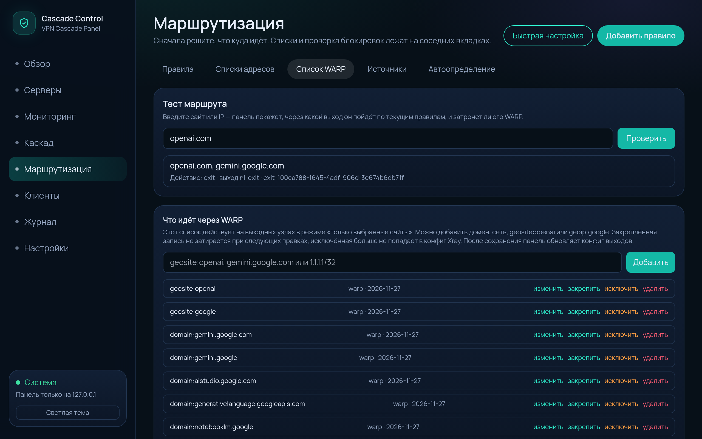
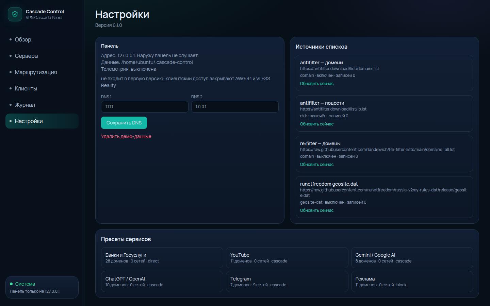
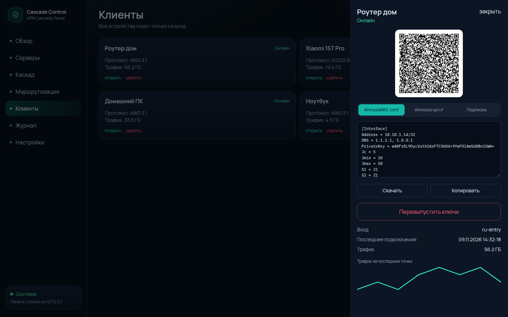
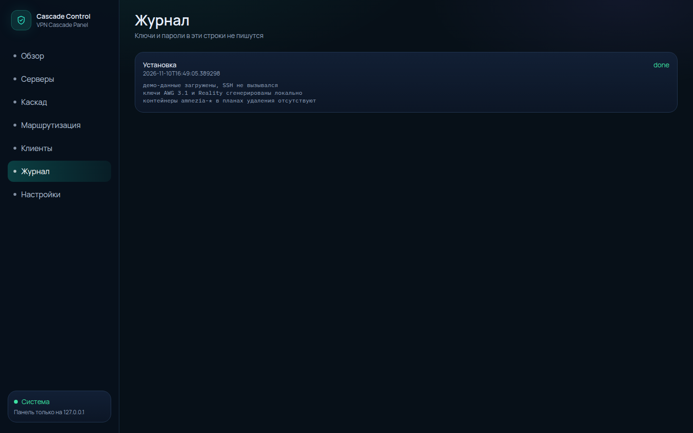

**[Русский](README.md)** · **[English](README.en.md)**

# Cascade Control

[](https://github.com/freeon1989/CascadeControl/releases/latest/download/CascadeControl-windows-x64.zip)

The archive `CascadeControl-windows-x64.zip` is on the [releases](https://github.com/freeon1989/CascadeControl/releases) page. In version 0.2.0 the program checks GitHub Releases and updates itself with the “Update” button; it can also offer to update the agent on the entry server. Earlier releases added a monitoring page, live client status, a one-button DNS site log and entry-node fixes.

The in-app “Download” button opens a “Save as” dialog.

Default ports are non-standard and can be changed on the server card.

## What it is

The panel runs only on your computer and listens on `127.0.0.1:47123`. It holds the database, keys and the install wizard. Every client (router, phone, PC) connects to a single entry node. At the entry, traffic either goes out to the internet directly or through a cascade: entry, then transit, then exit. An agent stays on the entry node: while the computer with the panel is off, the agent checks the exits and fails over. There is no telemetry.

## Requirements

Panel computer: Windows 10/11 x64 and Edge WebView2, or Linux or macOS with Python 3.11+. On Windows the window is drawn by WebView2. On Linux and macOS the panel opens in a browser at `http://127.0.0.1:47123`.

Each VPS: a public IPv4 address, a root or passwordless-sudo user, at least 2 GB of free disk (10 GB is better). Kernel 5.4 and newer is fine; kernel 4.18 (typical for AlmaLinux 8 and Rocky Linux 8) shows a warning and does not block the install.

Supported without a warning: Ubuntu 20.04, 22.04, 24.04, 25.x and 26.04; Debian 11, 12 and 13; AlmaLinux 8 and 9; Rocky Linux 8 and 9; CentOS Stream 9; Fedora 40–45. An unknown or newer release of those families stays a warning. A hard reject happens only if the system is not Linux, or it is OpenVZ/LXC without `/dev/net/tun`. Ordinary KVM is preferred.

On Ubuntu and Debian, packages are installed with `apt` (`nftables`, then Docker as `docker.io`, or `https://get.docker.com` as a fallback). On Alma, Rocky, CentOS Stream and Fedora, `dnf` is used. If firewalld is active, the panel does not disable it: an `inet cascade` nft table is added beside it.

## Installing the panel

### Windows

Download `CascadeControl-windows-x64.zip` and unpack it as a whole. The `_internal` folder must stay next to `CascadeControl.exe`. Run `CascadeControl.exe`. Do not close the black log window: that is the panel process.

If SmartScreen says the publisher is unknown, open “More info” and choose “Run anyway”. The file is not signed. If the UI window does not appear, the log will contain `http://127.0.0.1:47123` — open it in a browser. Data is stored in `%USERPROFILE%\.cascade-control`.

### In-app updates (Windows)

Settings → Updates. On startup (and then every few hours) the panel reads the public `api.github.com/repos/freeon1989/CascadeControl/releases/latest` and compares the version. If a new one is out, a note appears in the menu, and Settings shows the changelog and an “Update” button. Nothing is downloaded or installed until you click. Auto-check can be turned off, and a specific version can be skipped.

After you click:

1. `CascadeControl-windows-x64.zip` is downloaded over HTTPS only from GitHub hosts (any redirect to another host is rejected).
2. Its SHA-256 is checked against `CascadeControl-windows-x64.zip.sha256` from the same release. On mismatch the archive is deleted and install does not start.
3. The archive is unpacked into `%USERPROFILE%\.cascade-control\update` with path-escape protection.
4. The panel closes, a small `CascadeUpdater.exe` (copied to a temp folder) renames the old program folder to `CascadeControl.backup-<version>`, installs the new one, starts it and waits for `/api/health` with the new version. If that does not answer, the old folder is restored and started again. The rollback reason is visible in Settings.
5. The database, keys and servers live in `%USERPROFILE%\.cascade-control` and are not touched. Files you placed next to the program move into the new folder.

The previous version stays in `CascadeControl.backup-<version>` beside the program; you can delete it by hand. In-app install works only in the packaged Windows build. The GitHub request goes out with your IP like any other internet request; it contains no data about you or your servers.

The entry agent can be updated from the same Settings page after you confirm.

### Linux and macOS from source

```bash
# get the sources, create a venv, install panel packages
# build the UI into web/dist (otherwise the panel page is empty)
python3 -m cascade_panel   # listens only on 127.0.0.1:47123
```

See the [Russian README](README.md) for the exact commands.

## First cascade in five steps

1. If the overview already has tutorial nodes marked “demo”, open Settings and click “Delete demo data”. Otherwise the Entry role is already taken.
2. Servers → Add server. Enter a public IPv4, SSH and a role: one Entry, optionally Transit, one or more Exits. “Edit” on an existing server changes the name, address, SSH port, user, password or key, role, country and enabled protocols. Node keys are kept; a check runs again after save. “Status” immediately asks for CPU, memory, disk, uptime and a TCP ping. The same poll runs about every 30 seconds, including before install. A deployed entry also shows AWG handshakes and the Xray service.
3. On the Check step, wait for the report. “Deploy” is enabled only if there are no blocking items. OpenVZ, an unsupported OS, an old kernel and a disk smaller than 2 GB stop the install. A busy port 443 does not: another port is chosen.
4. Routing: Rules, Address lists, Sources and Auto-detect tabs. “Quick setup” sends Russian sites direct and everything else through the cascade, then enables YouTube, ChatGPT, Gemini and Telegram. “Add rule” asks first “what to route”, then “where”. A list source is added by name and URL; the panel assigns an internal id.
5. Cascade: when there is an entry and at least one exit, the panel builds the exit group and the chain itself. “Build automatically” does the same if a chain is not there yet. “Deploy all” installs exits first, then transit, then entry, and writes a log. Clients → New client: a name and protocol AWG 3.1 or VLESS Reality. Deletion asks for confirmation; “Reissue keys” changes the keys. For a router, open the `.conf` tab.

After you edit rules, clients or a server card, the node is marked “not pushed”. “Reconfigure” writes the current config over SSH again and does not remove the server from the list. “Update” applies the config the same way. “Recheck” repeats the check at any time. Red status text opens a report with each item, what failed and what to do.

## What the panel installs, and why

The panel installs AmneziaWG 3.1 (image `amneziavpn/amneziawg-go`) and Xray VLESS Reality, in an entry → transit → exit chain. Existing `amnezia-*` containers are only read; the uninstall script does not touch them. On the entry it also leaves an agent that can fail over exits while the panel computer is off.

## Interface

The screenshots below use a demonstration topology. Addresses are fictional, nodes are marked as demo. No real server keys or addresses are on the screens.

Overview of the topology: clients, the single entry, and the share of direct vs cascade traffic.



Cascade servers: roles, protocols and state.



Adding a server: the connection step in the check and install wizard.



Routing: rule order and exit balancing.



Address lists: feed sources and service presets.



Router config: the original AmneziaWG `.conf` tab and a QR code.



Install log: deploy steps with no passwords or keys in the text.



## What this version can do

- Overview, servers, monitoring, rules, clients, log and settings screens.
- Monitoring: CPU, memory, disk, uptime, `amnezia-*` and `cascade-*` containers, 24-hour charts, a summary and warnings in the log if a server disappears, a container stops or load grows.
- Sites from the DNS log. For `amnezia-dns` the panel can enable Unbound `log-queries` with a rotating archive (24 hours and 50 MB by default). On a cascade entry without `amnezia-dns`, the same button enables the Xray access log.
- Node check: virtualization, OS family, kernel, disk, Docker and port 443.
- Client `.conf` for AWG 3.1, a `vpn://` link, a QR code and a VLESS subscription.
- Rules: direct / cascade / a specific exit / block, weights and balancing strategies.
- Agent: TCP ping, a failure threshold, a fallback exit, and updates to the Xray selector.
- Panel updates from GitHub with a SHA-256 check and rollback, and an agent update on the entry after confirmation.

Tests on this machine cover the panel and the agent, the UI build and a local server. A production VPS was not brought up from here: installing on a real server needs your SSH.

## Development

Python 3.11+, Node.js 22 and Go 1.22 (only if you rebuild the agent):

```bash
python3 -m pip install -r requirements.txt
npm --prefix web ci
npm --prefix web run build
python3 -m pytest
cd agent && go test ./...
python3 -m cascade_panel
```

The panel opens at [http://127.0.0.1:47123](http://127.0.0.1:47123). The port is `CASCADE_PORT`. The default data directory is `~/.cascade-control` (`CASCADE_DATA_DIR`). The first launch loads a demonstration topology with fictional addresses and real local keys. You can delete it in Settings. Empty database: `CASCADE_SEED=0`.

The Windows zip is built on Linux with Wine (`./scripts/setup_wine_python.sh` then `./scripts/build_windows.sh`), or on Windows with `./scripts/build_windows.ps1`. The archive contains `CascadeControl.exe` (onedir: `_internal` must stay beside it), `CascadeUpdater.exe`, `README_RU.txt` and a linux/amd64 agent binary. No databases or keys are in the archive.

## Security

Secrets in SQLite are encrypted with AES-GCM; the key is in `master.key` with mode `0600`. Passwords and private keys do not appear in the log. The panel does not listen on external interfaces. The channel to the agent is SSH, over which the panel writes the config and fetches `status.json`.
