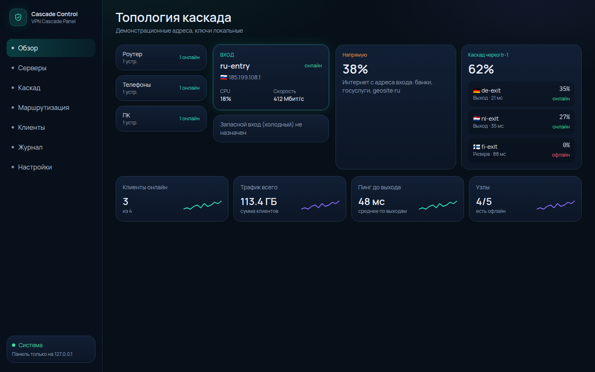
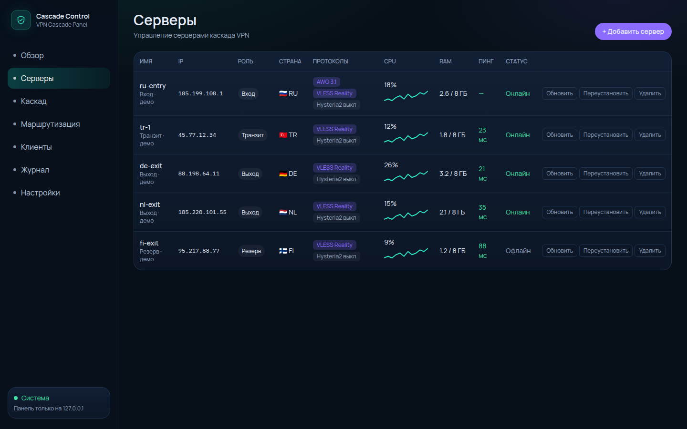
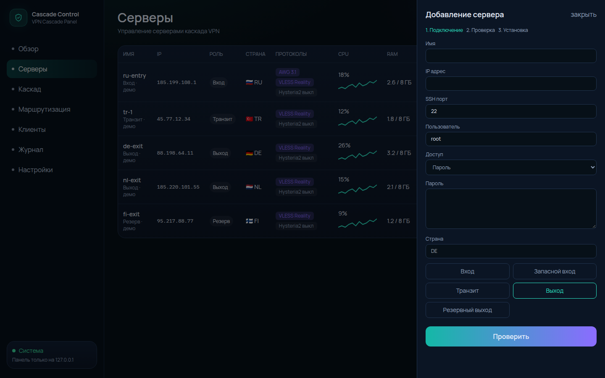
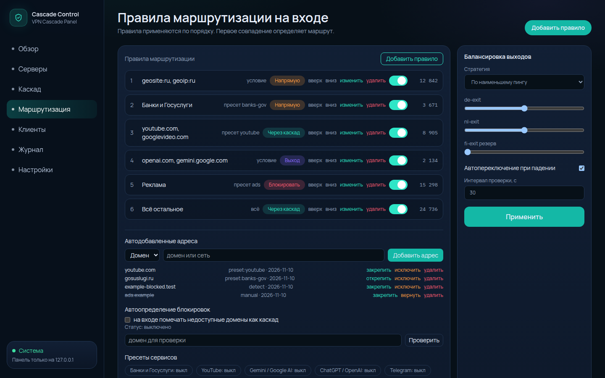
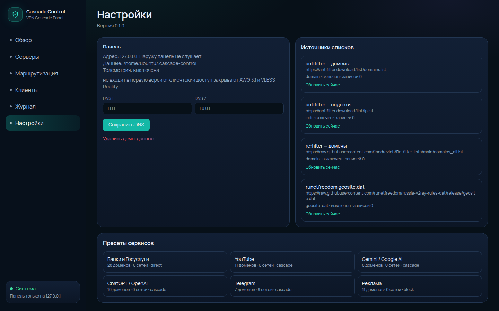
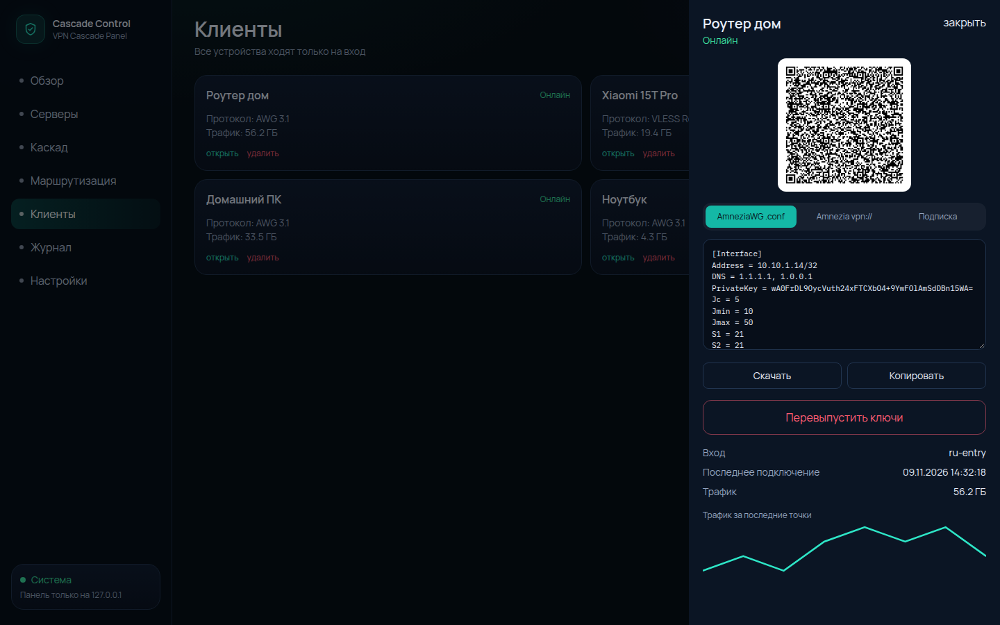
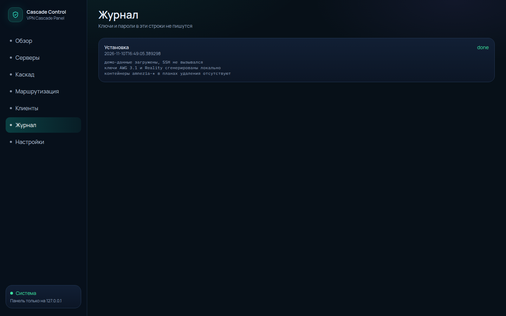

# Cascade Control

## Что это и как устроено

Панель работает только на вашем компьютере и слушает `127.0.0.1:47123`. В ней база, ключи и мастер установки. Все клиенты (роутер, телефон, ПК) подключаются только к одному входу. На входе трафик либо выходит в интернет напрямую, либо идёт каскадом: вход, затем транзит, затем выход. На входе остаётся агент: пока компьютер с панелью выключен, он проверяет выходы и переключает их. Телеметрии нет.

## Что нужно

Компьютер с панелью: Windows 10/11 x64 и Edge WebView2, либо Linux или macOS с Python 3.11+. На Windows окно рисует WebView2. На Linux и macOS панель открывается в браузере по адресу `http://127.0.0.1:47123`.

Каждый VPS: публичный IPv4, пользователь root или sudo без запроса пароля, свободно хотя бы 2 ГБ на диске (лучше от 10 ГБ). Ядро 5.4 и новее проходит без замечаний, ядро 4.18 (типичное для AlmaLinux 8 и Rocky Linux 8) даёт предупреждение и не блокирует установку.

Системы без предупреждения: Ubuntu 20.04, 22.04, 24.04, 25.x и 26.04; Debian 11, 12 и 13; AlmaLinux 8 и 9; Rocky Linux 8 и 9; CentOS Stream 9; Fedora 40-45. Незнакомая или более новая версия этих семейств остаётся предупреждением. Жёсткий отказ по среде только если система не Linux или это OpenVZ/LXC без `/dev/net/tun`. Обычный KVM предпочтительнее.

На Ubuntu и Debian пакеты ставятся через `apt`: `nftables`, затем Docker пакетом `docker.io`. Если пакета нет, скрипт вызывает `https://get.docker.com` и снова пробует `docker.io`. На Alma, Rocky, CentOS Stream и Fedora пакеты ставятся через `dnf` (`nftables`, Docker из репозитория или `get.docker.com`). Если активен firewalld, панель его не выключает: таблица nft `inet cascade` добавляется рядом.

Порты, которые должны быть доступны снаружи, если на сервере включён фаервол. Панель сама ufw не настраивает.

| Роль | Что открыть |
| --- | --- |
| Вход | SSH (обычно 22), UDP AmneziaWG и TCP Reality из свободного диапазона 20000-60000 (не 51820, 443, 8443 и 10808, пока их явно не зададут). Внутренний tproxy 10808 наружу не открывается. Порты правятся в карточке сервера |
| Транзит | SSH и TCP Reality (сначала 8443) |
| Выход | SSH и TCP Reality (443, если занят то от 2053) |

Нужен один вход и хотя бы один выход. Транзит необязателен. Запасной вход и резервный выход можно добавить позже.

## Установка панели

### Windows

Скачайте архив `CascadeControl-windows-x64.zip` и распакуйте его целиком. Рядом с `CascadeControl.exe` должна остаться папка `_internal`. Запустите `CascadeControl.exe`. Чёрное окно журнала не закрывайте: это и есть процесс панели.

Если SmartScreen пишет, что издатель неизвестен, откройте «Подробнее» и выберите «Выполнить в любом случае». Файл не подписан. Если окно интерфейса не появилось, в журнале будет адрес `http://127.0.0.1:47123`, откройте его в браузере. Данные лягут в `%USERPROFILE%\.cascade-control`.

### Linux и macOS из исходников

```bash
git clone https://github.com/freeon1989/CascadeControl.git
# забирает исходники
cd CascadeControl
python3 -m venv .venv
# отдельное окружение Python, пакеты не ставятся в систему
source .venv/bin/activate
pip install -r requirements.txt
# библиотеки панели: веб-сервер, SSH, шифрование, QR
npm --prefix web ci
npm --prefix web run build
# собирает интерфейс в web/dist, без этого страница панели пустая
python3 -m cascade_panel
# слушает только 127.0.0.1:47123
```

Каталог данных: `~/.cascade-control`. Другой порт: `CASCADE_PORT`. Пустая база без демо: `CASCADE_SEED=0`.

## Первый каскад за 5 шагов

1. Если на обзоре уже есть учебные узлы с пометкой «демо», откройте «Настройки» и нажмите «Удалить демо-данные». Иначе роль «Вход» уже занята.
2. «Серверы», «Добавить сервер». Укажите публичный IPv4, SSH и роль: один «Вход», при желании «Транзит», один или несколько «Выход». У уже добавленного сервера «Изменить» правит имя, адрес, порт SSH, пользователя, пароль или ключ, роль, страну и включённые протоколы. Ключи узла при этом сохраняются, после сохранения проверка запускается снова. «Статус» сразу спрашивает CPU, память, диск, аптайм и TCP-пинг. Тот же опрос идёт сам примерно каждые 30 секунд, в том числе до установки. У развёрнутого входа видны рукопожатия AWG и служба Xray.
3. На шаге «Проверка» дождитесь отчёта. Кнопка «Развернуть» активна только если нет блокирующих пунктов. OpenVZ, чужая ОС, старое ядро и диск меньше 2 ГБ установку останавливают. Занятый порт 443 установку не останавливает: будет выбран другой.
4. «Маршрутизация»: вкладки «Правила», «Списки адресов», «Источники» и «Автоопределение». «Быстрая настройка» создаёт российские сайты напрямую и всё остальное через каскад, затем включает YouTube, ChatGPT, Gemini и Telegram. «Добавить правило» спрашивает сначала «что направить», потом «куда». Источник списка добавляется по названию и ссылке, внутренний номер панель ставит сама.
5. «Каскад»: когда есть вход и хотя бы один выход, панель сама собирает группу выходов и цепочку. Кнопка «Собрать автоматически» делает то же самое, если цепочки ещё нет. «Развернуть всё» ставит сначала выходы, потом транзит, затем вход, и пишет журнал. «Клиенты», «Новый клиент»: имя и протокол AWG 3.1 или VLESS Reality. Удаление спрашивает подтверждение, «Перевыпустить ключи» меняет ключи. Для роутера откройте вкладку `.conf`.

После правки правил, клиентов или карточки сервера узел помечается «не отправлено». «Перенастроить» заново записывает текущий конфиг по SSH и не удаляет сервер из списка. «Обновить» делает то же применение конфига. «Перепроверить» повторяет проверку в любой момент, не только после ошибки. Красный текст статуса открывает отчёт: каждый пункт, что не сошлось и что сделать. В отчёте есть «Повторить проверку».

## Что панель ставит на серверы и зачем

| Что появляется | На какой роли | Зачем |
| --- | --- | --- |
| Контейнер `cascade-awg`, образ `amneziavpn/amneziawg-go`, интерфейс `cawg0` | Только вход | Клиентский AmneziaWG 3.1. Существующие контейнеры `amnezia-*` не удаляются |
| Бинарник `/opt/cascade/bin/xray` (Xray `v26.10.31`) и служба `cascade-xray` | Вход, первый транзит, выходы | VLESS Reality. На входе делит прямой выход и каскад, на транзите ведёт к выбранному выходу, на выходе выпускает трафик в интернет |
| `/usr/local/bin/cascade-agent` и служба `cascade-agent` | Только вход | Проверка выходов, переключение балансировщика и подписка на порту 2096, пока панель закрыта |
| Таблица nftables `inet cascade` | Вход | Ставит метку `0x63` и только потом забирает IPv4 с `cawg0` в Xray на `:10808`. `src_valid_mark` остаётся 0, иначе ядро выбрасывает ответ клиенту. IPv6 с туннеля отбрасывается |
| Пакеты `docker.io` или Docker через `dnf` / get.docker.com, `nftables`, `curl`, `unzip` | Если их ещё нет | На apt-системах ставится `docker.io`, на dnf-системах пакет Docker или get.docker.com. firewalld не выключается |

Проверка на самом сервере после «Развернуть»:

```bash
systemctl status cascade-xray
# служба Xray в состоянии active
systemctl status cascade-agent
# на входе агент в состоянии active, на транзите и выходе этой службы нет
sudo docker ps --filter name=cascade-awg
# на входе контейнер AWG запущен
sudo docker exec cascade-awg awg show cawg0
# пиры AmneziaWG и время последнего рукопожатия
sudo nft list table inet cascade
# правило tproxy для интерфейса cawg0
journalctl -u cascade-xray -u cascade-agent -n 50 --no-pager
# последние строки журнала этих двух служб
ss -lntup
# видны порт Reality и, на входе, порт 2096
```

## Частые проблемы

Окно панели на Windows не открылось. Смотрите чёрное окно: там адрес `http://127.0.0.1:47123`. Для встроенного окна нужны WebView2 и .NET Framework. Консоль закрывать нельзя, иначе панель остановится.

«Развернуть» не нажимается. Нажмите на красный статус в таблице серверов: там полный отчёт и список поддерживаемых систем. Жёстко останавливают установку не-Linux, OpenVZ или LXC без `/dev/net/tun`, ядро старше 4.18 и диск меньше 2 ГБ. Ubuntu 20.04, 22.04, 24.04, 25.x, 26.04, Debian 11, 12, 13, AlmaLinux 8 и 9, Rocky Linux 8 и 9, CentOS Stream 9 и Fedora 40-45 проходят. Другая версия этих семейств даёт предупреждение, а не отказ. Занятый порт 443 и уже установленный Docker с Amnezia установку не останавливают. Исправьте сервер и нажмите «Перепроверить».

Установка обрывается на `sudo`. В панели указан не root, а sudo просит пароль. Укажите root или настройте sudo без пароля для этого пользователя.

Клиент не подключается. В конфиге должен быть публичный адрес входа и тот порт, который панель показала в таблице серверов после проверки. Если на VPS включён фаервол, откройте UDP AWG и TCP Reality вручную.

Цепочка не собирается. Нужны ровно один активный вход и хотя бы один выход. Пока их нет, установка пишет, чего не хватает. Учебные узлы с пометкой «демо» по SSH не ставятся: сначала удалите демо в «Настройках».

Подробности протоколов и границ этой версии: [docs/architecture.md](docs/architecture.md).

## Интерфейс

Снимки ниже сняты на демонстрационной топологии. Адреса вымышленные, узлы помечены как демо. Ключей и адресов реальных серверов на экранах нет.

Обзор топологии: клиенты, единственный вход, доля прямого выхода и каскада.



Серверы каскада: роли, протоколы и состояние.



Добавление сервера: шаг подключения в мастере проверки и установки.



Маршрутизация: порядок правил и балансировка выходов.



Списки адресов: источники пополнения и пресеты сервисов.



Конфиг роутера: вкладка оригинального AmneziaWG `.conf` и QR.



Журнал установки: шаги развёртывания без паролей и ключей в тексте.



## Запуск для разработки

Нужны Python 3.11+, Node.js 22 и Go 1.22 (только если пересобираете агента).

```bash
python3 -m pip install -r requirements.txt
npm --prefix web ci
npm --prefix web run build
python3 -m pytest
cd agent && go test ./...
python3 -m cascade_panel
```

Панель откроется на [http://127.0.0.1:47123](http://127.0.0.1:47123). Порт меняется переменной `CASCADE_PORT`. Каталог данных по умолчанию — `~/.cascade-control` (`CASCADE_DATA_DIR`). При первом запуске загружается демонстрационная топология с вымышленными адресами и настоящими локальными ключами. Её можно удалить в «Настройках».

Чтобы начать с пустой базы: `CASCADE_SEED=0`.

Интерфейс в режиме правки без пересборки:

```bash
npm --prefix web run dev   # http://127.0.0.1:47124, API проксируется на панель
```

## Windows

Готовый каталог для компьютера владельца собирается на Linux через Wine и официальный CPython amd64:

```bash
./scripts/setup_wine_python.sh
./scripts/build_windows.sh
```

Архив `build/CascadeControl-windows-x64.zip` содержит `CascadeControl.exe` (сборка onedir: рядом обязательна папка `_internal`), `README_RU.txt` и linux/amd64 бинарник агента. Базы и ключей в архиве нет. Первый запуск создаёт учебную схему и помечает её как демо; ключи генерируются уже на том компьютере.

На самой Windows, если стоят Python, Node, Go и WebView2, тот же результат даёт `./scripts/build_windows.ps1`. GitHub Actions `windows-exe` повторяет этот сценарий. Окно панели — pywebview поверх локального сервера. Если окно не открылось, адрес остаётся в консоли: `http://127.0.0.1:47123`.

## Что умеет эта версия

- Экраны обзора, серверов, мониторинга, правил, клиентов, журнала и настроек.
- Мониторинг: CPU, память, диск, аптайм, контейнеры `amnezia-*` и `cascade-*`, графики за сутки, сводка и предупреждения в журнале, если сервер пропал, контейнер остановился или выросла нагрузка.
- Сайты по журналу DNS. Для `amnezia-dns` панель по кнопке включает `log-queries` в Unbound, кладёт лог рядом с конфигом и крутит `log-archive` каждые 15 минут (по умолчанию 24 часа и 50 МБ). На входе каскада без `amnezia-dns` та же кнопка включает access-лог Xray. Выключение возвращает запись назад. Если контейнер пересоздали и настройка пропала, страница предлагает применить её снова.
- Узел: проверка виртуализации, семейства ОС (Ubuntu, Debian, Alma, Rocky, CentOS Stream, Fedora), ядра, диска, Docker и порта 443. Контейнеры `amnezia-*` только читаются, скрипт удаления их не трогает.
- Установка AmneziaWG 3.1 (образ `amneziavpn/amneziawg-go`) и Xray VLESS Reality, цепочка вход → транзит → выход.
- Клиентский `.conf` AWG 3.1, ссылка `vpn://`, QR и подписка VLESS.
- Правила direct / cascade / конкретный выход / block, веса и стратегии балансировки.
- Агент: пинг TCP, порог отказов, запасной выход, правка селектора Xray.

Проверка на этой машине — модульные тесты панели и агента, сборка интерфейса и локальный сервер. Боевой VPS отсюда не поднимался: установка на реальный сервер потребует вашего SSH.

## Безопасность

Секреты в SQLite зашифрованы AES-GCM, ключ лежит в `master.key` с правами `0600`. Пароли и приватные ключи не попадают в журнал. Панель не слушает внешние интерфейсы. Канал к агенту — SSH, по которому панель записывает конфиг и забирает `status.json`.
