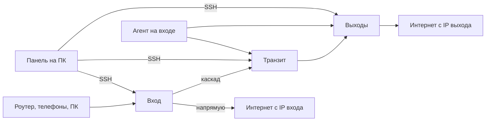

# Архитектура Cascade Control

Документ фиксирует решения первой рабочей версии и то, что проверено по исходникам Amnezia, а не по примеру из макета.

## Роли

Один активный вход. Запасной вход может быть один, он холодный: контейнеры на нём не поднимаются, пока роль не сменят. Транзитов и выходов может быть несколько. В этой версии в живую цепочку входит первый транзит; остальные сохраняются и помечаются в плане. Резервный выход в балансировщик не входит, пока агент не увидит отказ основных.

Клиент никогда не получает адрес транзита или выхода. В `.conf` и в `vless://` endpoint — только вход.

## Почему панель локальная, а агент на входе

Панель хранит базу и ключи у владельца, как AmneziaMonitor: процесс на своём компьютере, интерфейс на loopback. Пока компьютер выключен, вход всё равно должен проверять выходы и переключать их. Поэтому на вход ставится отдельный процесс. Панель при открытии и при установке записывает ему конфиг и забирает статус по SSH. Отдельный порт управления с mTLS не открывается: SSH уже есть и аутентифицирован ключом или паролем владельца.

## Почему агент на Go

Нужен один файл под linux/amd64, без интерпретатора на VPS и без обязательного `docker pull` для самого агента. Go это даёт (`CGO_ENABLED=0`). Панель кладёт бинарник в `/opt/cascade/bin/cascade-agent` и включает systemd. Dockerfile в `agent/` собирает тот же бинарник в образ, если так удобнее сопровождать, но установка из панели его не требует.

## Данные

SQLite в каталоге данных (`~/.cascade-control/cascade.db`).

| Таблица | Смысл |
| --- | --- |
| servers | адрес, роль, порты, публичные ключи, зашифрованные секреты SSH и протоколов |
| clients | устройство, протокол, адрес AWG или UUID VLESS, токен подписки |
| routing_rules | порядок, JSON-условие, действие, счётчик |
| balance | стратегия, интервал, веса выходов |
| address_entries | домен или сеть, источник, дата, закрепление, исключение |
| list_sources | URL списков |
| jobs, job_lines | журнал установки |

`HeaderProtectionKey`, приватные ключи WireGuard и Reality, PSK и SSH-секрет лежат только в столбцах `*_enc` (AES-GCM). В JSON параметров AWG поле ключа пустое. Журнал прогоняется через фильтр, который затирает строки вида `PrivateKey = ...`.

## Установка

1. Панель кладёт `/opt/cascade/precheck.sh` и читает строку `CASCADE_JSON`.
2. Жёсткий отказ: OpenVZ, LXC, LXD, контейнер; не Ubuntu 22.04/24.04 и не Debian 12; ядро старше 5.4; меньше 2 ГБ свободно. Предупреждение, не блок: порт 443 занят, Docker не установлен, диск меньше 10 ГБ.
3. Занятые порты и контейнеры `amnezia-*` запоминаются. Свои контейнеры называются только `cascade-*`. `render_install_script` отказывается собираться, если в тексте есть `amnezia-` рядом с удалением. Образ AWG — официальный `amneziavpn/amneziawg-go`, но имя контейнера `cascade-awg`, чтобы не задеть уже стоящий `amnezia-awg`.
4. AWG поднимается в сети хоста, интерфейс `cawg0` (файл `cawg0.conf`, так `awg-quick` называет интерфейс). Весь IPv4 с туннеля уходит в tproxy Xray (`127.0.0.1:10808`). IPv6 с туннеля пока отбрасывается, чтобы он не утёк мимо правил.
5. Xray — бинарник с тега `v26.10.31` (тот же релиз, что в Dockerfile клиента Amnezia) и systemd `cascade-xray`.
6. На вход дополнительно ставится агент.

Повторная установка и «переустановить» гоняют тот же сценарий: свои контейнеры пересоздаются, ключи в базе не меняются. «Удалить» вызывает `remove.sh`, который снимает только `cascade-awg`, службы каскада и `/opt/cascade`.

## Протоколы

### AmneziaWG 3.1

Сверено с веткой `dev` клиента на момент сборки:

- [`awgInstaller.cpp`](https://github.com/amnezia-vpn/amnezia-client/blob/dev/client/core/installers/awgInstaller.cpp) — `generateAwgParameters`: Jc случайный 4…6, Jmin = 10, Jmax = 50, S1…S4 = 12, H1…H4 = 1…4, `HeaderProtectionKey` как `awg genkey`, `RandomTrailers=on`, `DisableCookies=on`.
- [`protocolConstants.h`](https://github.com/amnezia-vpn/amnezia-client/blob/dev/client/core/utils/constants/protocolConstants.h) — окна `10-100`, `100-120`, `3-7`, `150-180`, `5-15`, `15-20`, keepalive `25-35`.
- [`template.conf`](https://github.com/amnezia-vpn/amnezia-client/blob/dev/client/server_scripts/awg/template.conf) — порядок полей клиентского конфига. Пустые I1…I5 официальный скрипт вырезает, генератор 3.1 их не задаёт, в наш `.conf` они не попадают.
- README [amneziawg-go](https://github.com/amnezia-vpn/amneziawg-go): при Header Protection каждый из S1…S4 не меньше 12, диапазоны — `lo-hi`.
- Вывод [обсуждения #3073](https://github.com/amnezia-vpn/amnezia-client/issues/3073): вместе с HeaderProtectionKey заголовки остаются 1, 2, 3, 4. Диапазоны H при `RandomTrailers=on` дают тихую потерю пакетов. Поэтому H мы не рандомим.
- `AwgConstant`: размеры сообщений 148 / 92 / 64 / 32. Совпадение `base+S` на проводе запрещено. При равных S размеры различаются сами, и равные S как раз рекомендуются при RandomTrailers.

Генератор этой панели на каждый узел заново берёт Jc (4…6), общий S (12…32, копируется в S1…S4), ключ заголовка, поддиапазоны padding и таймингов внутри официальных окон. Верх `RekeyAfterTime` всегда ниже низа `RejectAfterTime`, потому что окна 100–120 и 150–180 не пересекаются. `ContentPaddingAddition` официальный установщик сейчас не пишет (пустая строка вырезается), но константа и шаблон задают `10-100`, и поле нужно роутеру владельца — мы его пишем.

Ключ WireGuard — 32 байта с clamping, публичная часть X25519, base64 как у `wg genkey`.

### Ссылка vpn://

Как в `ExportController` клиента: JSON, затем `qCompress` (4 байта длины big-endian и zlib), затем base64url без `=`. `last_config` — строка со вторым JSON, не вложенный объект. Контейнер в конверте называется `amnezia-awg`, чтобы штатное приложение Amnezia увидело профиль AWG 3.1. Это имя формата импорта, а не имя docker-контейнера на сервере.

### VLESS Reality

Ключи X25519 в обычном base64, short id — 16 hex-символов, flow `xtls-rprx-vision`, SNI по умолчанию `www.googletagmanager.com` (значение клиента Amnezia). Подписка — base64 от строки `vless://`, её отдаёт и панель (`/sub/<token>` на loopback), и агент на входе (`0.0.0.0:2096/sub/<token>`).

### Цепочка

На входе у каждого активного выхода свой outbound с тегом `exit-<id>`. Если транзит есть, этот outbound смотрит на транзит, а пользователь VLESS равен id выхода. Транзит по полю `email` отправляет этот поток на нужный выход. Агенту достаточно переписать `selector` балансировщика `cascade` на входе — конфиг транзита при отказе не трогается.

Прямой трафик — outbound `freedom` (уходит с IP входа). Блок — `blackhole`. Разбор домена делает sniffing с `routeOnly`, чтобы freedom сохранил исходный адрес назначения.

Межузловой транспорт по умолчанию VLESS Reality. Поле `link_protocol` на сервере уже хранится (`vless` или `awg`); сборщик этой версии строит VLESS. Отдельный AWG между узлами — следующий шаг, интерфейс роли и поле под него есть.

Hysteria2 не разворачивается. В интерфейсе бейдж «выкл», модуль `hysteria.py` возвращает причину.

## Правила

Первое включённое совпадение. Условие — JSON: домен, список доменов, `geosite`, `geoip`, CIDR, пресет, `any_of`, `any: true`. Пресеты (банки и госуслуги, YouTube, Gemini, OpenAI, Telegram, реклама) раскрываются и в движке, и в правилах Xray.

Действия: `direct`, `cascade` (балансировщик), `exit` (конкретный id), `block`.

Списки. Текстовые домены и CIDR разбираются и на панели, и в агенте. Источники по умолчанию: antifilter (включён) и re:filter (выключен). Бинарный `geosite.dat` runetfreedom в этой версии не парсится: источник есть, обновление пишет понятную ошибку. Записи помнят источник и дату. Закреплённую запись обновление не переписывает, исключённую не создаёт снова.

Детектор. Сброс, таймаут и страница с типичной заглушкой РКН дают действие `cascade`. С панели это `POST /api/detect/probe` (живой запрос) и `POST /api/detect/classify` (уже известный ответ). Агент дополнительно отмечает домены из `watch_domains`, если прямой TCP:443 не открылся. Разбор тела страницы на агенте в цикле пока не делается — классификатор есть, HTTP-проба есть на панели.

## Интерфейс

Тёмный интерфейс на React и Tailwind, строки по-русски. Четыре основных экрана повторяют приложенные макеты по составу, не по пикселям: обзор с долями direct/cascade, таблица серверов и мастер из трёх шагов, список правил с перетаскиванием и панель весов, карточки клиентов с QR и вкладками `.conf` / `vpn://` / подписка.

## Сборка Windows

`cascade-panel.spec` упаковывает `webview_host.py` и `web/dist`. В замороженном процессе каталог интерфейса берётся из `sys._MEIPASS`. Workflow `.github/workflows/ci.yml` на Ubuntu гоняет pytest, `go test` и `npm run build`, на Windows собирает exe и публикует артефакт.

## Что проверено здесь

- Сотня профилей AWG: границы Jc, S, H, ключ, непересечение таймингов, порядок полей `.conf`.
- Круговой разбор `vpn://`.
- Движок правил, компиляция в Xray, разбор предпроверки, классификатор блокировок, парсер списков.
- API: обзор, экспорт, перестановка правил, ложный SSH-прогон установки. В скрипте нет удаления `amnezia-*`, в журнал не попадает пароль.
- Агент: порог отказа и подъём резерва, сортировка по пингу, круг, веса, правка только селектора Xray.

Не проверялось: реальный `docker run` на KVM, рукопожатие AWG с роутером, импорт в мобильное приложение Amnezia на устройстве.

## Дальше

1. Прогон установки на чистой Ubuntu 24.04 и сверка, что соседний `amnezia-awg` жив.
2. Импорт `.conf` и `vpn://` в штатный клиент и в роутер с AWG 3.1.
3. Съём трафика через `awg show` в статус агента и график по часам.
4. Разбор `geosite.dat` / `geoip.dat` и расписание на агенте.
5. HTTP-проба заглушек в цикле агента, а не только TCP.
6. Второй транзит и выбор протокола звена AWG либо VLESS в интерфейсе.
7. Hysteria2 как необязательный клиентский вход.
8. IPv6-tproxy вместо отбрасывания.
9. Подпись exe и проверка WebView2 на чистой Windows без установленного Python.
